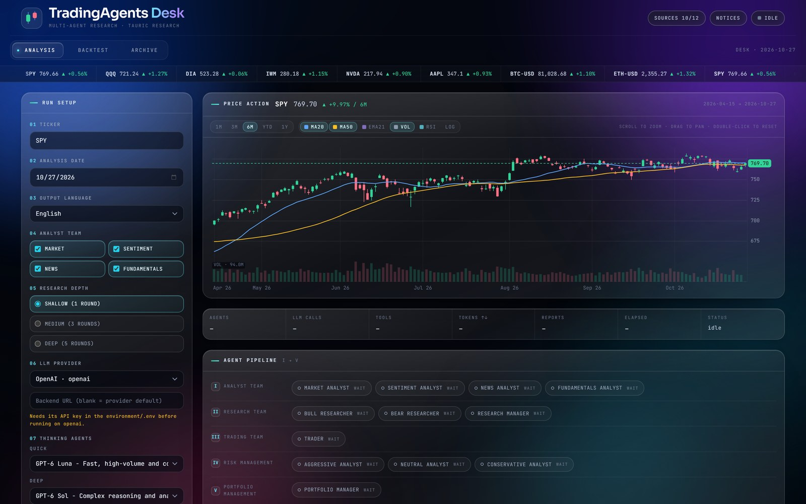

<div align="center">

# TradingAgents Web

**A self-hosted research desk for [TradingAgents](https://github.com/TauricResearch/TradingAgents).**

Stream a multi-agent analysis, sweep a dated backtest, and read every report — from one page on your own machine.

[](https://www.python.org/)
[](LICENSE)
[](https://github.com/TauricResearch/TradingAgents)

</div>



> A research tool for studying multi-agent analysis. Not financial, investment or trading advice.

## What this is

[Upstream TradingAgents](https://github.com/TauricResearch/TradingAgents) is a LangGraph pipeline of LLM analysts, researchers, a trader and a risk team, plus the CLI and data layer that feed them. This fork keeps all of that and adds a web desk on top, tracking upstream **v0.7.1**.

What the fork adds:

- **`web/`** — a FastAPI backend and one static page. No npm, no build step. A run streams over SSE and mirrors what the CLI prints: the pipeline, messages and tool calls, token stats, the final report.
- **Backtests on the engine you picked** — the Backtest tab runs the same provider, models and depth as Run setup, stamps them into the sweep, and warns when a resumed run id would mix engines.
- **An interactive price chart** — 1M/3M/6M/YTD/1Y ranges, MA20/MA50/EMA21, volume and RSI panes, log scale, crosshair readout, wheel zoom, drag pan, keyboard and touch.
- **Deeper vendor fallbacks** — Twelve Data, Tiingo, Finnhub, Kalshi and Manifold join the default chains, and every vendor switch is reported in the run log.
- **Tests for all of it** — `tests/test_web_*.py`, `test_route_observer.py`, `test_fallback_vendors.py`.

## Quick start

Requires **Python 3.11+** and an API key for one LLM provider.

```bash
git clone https://github.com/Zaawar/TradingAgentsWeb.git
cd TradingAgentsWeb

python -m venv .venv
source .venv/bin/activate        # Windows: .\.venv\Scripts\Activate.ps1

pip install -e ".[web]"
```

Create your environment file and add a provider key:

```bash
cp .env.example .env             # Windows: Copy-Item .env.example .env
```

```bash
OPENAI_API_KEY=sk-...
```

Start the server and open <http://localhost:8000>:

```bash
uvicorn web.server:app --port 8000
```

`pip install ".[web]"` adds FastAPI and uvicorn. For the CLI alone, `pip install .` is enough.

> The desk has no login and no authentication. It binds to `127.0.0.1` by default — keep it there, or put it behind a VPN or reverse proxy if you need to reach it from another machine.

## Choosing a model

The desk supports the same providers as the CLI: OpenAI, Google, Anthropic, xAI, DeepSeek, Qwen, GLM, MiniMax, OpenRouter, Mistral, Kimi, Groq, NVIDIA NIM, Azure OpenAI, Amazon Bedrock, Ollama, a ChatGPT Plus/Pro plan, and any OpenAI-compatible endpoint (vLLM, LM Studio, llama.cpp, a relay).

Provider keys can live in `.env`:

```bash
ANTHROPIC_API_KEY=...
```

…or you can point at a local server:

```bash
TRADINGAGENTS_LLM_PROVIDER=openai_compatible
TRADINGAGENTS_LLM_BACKEND_URL=http://127.0.0.1:8001/v1
TRADINGAGENTS_DEEP_THINK_LLM=<your-model-id>
TRADINGAGENTS_QUICK_THINK_LLM=<your-model-id>
```

Run setup can override the provider, backend URL, both models and the reasoning effort per run, and those choices drive **both** tabs. The `TRADINGAGENTS_*` variables pre-fill the form; CLI runs read them directly.

For a ChatGPT Plus/Pro plan there is no key to paste — sign in once:

```bash
tradingagents login chatgpt
```

Settings worth knowing:

| Variable | Effect |
|---|---|
| `TRADINGAGENTS_LLM_PROVIDER` | provider key, e.g. `openai`, `anthropic`, `ollama` |
| `TRADINGAGENTS_DEEP_THINK_LLM` / `..._QUICK_THINK_LLM` | manager models vs analyst models |
| `TRADINGAGENTS_MAX_DEBATE_ROUNDS` / `..._MAX_RISK_ROUNDS` | research depth (1 / 3 / 5 rounds) |
| `TRADINGAGENTS_OUTPUT_LANGUAGE` | report language |
| `TRADINGAGENTS_RESULTS_DIR` / `..._CACHE_DIR` / `..._MEMORY_LOG_PATH` | where reports, checkpoints and the memory log live |

Everything defaults under `~/.tradingagents`.

## Using the desk

| Tab | What it does |
|---|---|
| **Analysis** | Run setup, the live I–V agent pipeline, messages and tool calls, token stats, the finished report with its rating gauge, and `.md` / `.html` downloads. |
| **Backtest** | The `backtest` subcommand with live per-cell progress, the scored summary, and issue notes. |
| **Archive** | Browse, filter, preview, download and delete saved reports. |

The header carries a scrolling quote tape, a **Sources** button that probes each market-data vendor on demand, **Notices** for release information, and the run status.

Run setup collects the ticker (with SEC EDGAR-backed autocomplete), the analysis date, output language, analyst team, research depth, LLM provider and models, reasoning effort, and an optional portfolio JSON. Leave the portfolio blank and the agents write for a reader who applies the guidance themselves; an empty `positions` list means a flat book.

Only one run is active at a time; the active Run button becomes **Stop**, which aborts the browser's stream and idles the panel.

### HTTP surface

Everything the page does is a plain JSON or SSE endpoint, so the desk is scriptable:

| Endpoint | Purpose |
|---|---|
| `GET /api/meta` | providers, model catalog, languages, depths, saved form preferences |
| `POST /api/analyze` | start an analysis; the response is an SSE stream |
| `POST /api/backtest` | start a sweep; the response is an SSE stream |
| `GET /api/candles?ticker=&date=&days=` | daily OHLC for the chart (`days` 30–900) |
| `GET /api/quotes` | quote tape |
| `GET /api/symbols?q=` | ticker autocomplete from SEC EDGAR's ticker map |
| `GET /api/history` · `GET/DELETE /api/history/{name}` | saved reports |
| `GET /api/health` | on-demand vendor probes |

## The price chart

The chart is drawn on a canvas with no charting dependency, in the same glass style as the rest of the desk.

| | |
|---|---|
| **Ranges** | `1M` `3M` `6M` `YTD` `1Y` |
| **Overlays** | MA20, MA50, EMA21, volume, RSI(14), log scale — each toggled independently |
| **Crosshair** | bar highlight, price guide and close tag on the right scale, date tag on the time axis, and an OHLCV readout in the header |
| **Mouse** | scroll to zoom at the cursor, drag to pan, double-click to reset |
| **Keyboard** | focus the chart, then `←` / `→` to inspect a session (hold `Shift` for 10), `+` / `−` to zoom, `Home` or `0` to reset |
| **Touch** | tap to inspect a session, drag to pan; vertical scrolling still works |

Data comes from `/api/candles`, served through the `core_stock_apis` vendor chain, so it falls back across vendors exactly as the agents do. The client fetches roughly a year once and slices every range locally, so changing range or zooming costs no extra vendor calls. The server clamps the lookback to 30–900 days (195 for a bare API client).

The chart follows Run setup: changing the ticker or date, or starting a run, re-anchors it. On a phone it opens on 3M instead of squeezing half a year into ~360 px; an explicit range pick is never overridden.

## Backtest

A sweep runs the full agent stack at each rebalance date and scores the decisions whose holding window has since traded. Each cell is entered at the first close after its analysis date, and alpha is measured against the instrument's regional benchmark.

- **Same engine as Run setup.** Provider, endpoint, quick/deep models and depth are applied to every cell, so the Backtest tab cannot silently run on a different model than the Analysis tab.
- **Cached and resumable.** Cells are cached per `(ticker, date)`. Re-running with the same **Run ID** skips completed cells, so an interrupted sweep continues where it stopped.
- **Stamped.** The engine is written to `run.json` next to the sweep. If a resumed run ID was computed with a different engine, the Issues panel says so instead of mixing results silently.

The CLI runs the same thing:

```bash
tradingagents backtest NVDA,AAPL --start 2026-06-01 --end 2026-08-01 --every 7
```

## CLI

The CLI is the upstream one plus vendor route notices in the live feed, and it needs no web dependencies:

```bash
pip install .

tradingagents                                     # interactive, asks each step
tradingagents --ticker NVDA --date 2026-09-01 --analysts market,news --save --no-show
tradingagents --portfolio my_book.json             # size against your actual book
tradingagents --checkpoint                         # resume a crashed run
tradingagents --clear-checkpoints                  # reset saved checkpoints first
```

`python -m cli.main` works too. Reports land in `results_dir/reports/` (`~/.tradingagents/logs/reports` by default) as markdown plus a single `complete_report.html`.

### Memory and checkpoints

- **Memory log.** Every completed run appends its decision to `~/.tradingagents/memory/trading_memory.md`. While a later run's analysts work, matured decisions are settled — realised return, alpha against the regional benchmark, and a one-paragraph reflection — and the Portfolio Manager reads the recent ones back. Override the path with `TRADINGAGENTS_MEMORY_LOG_PATH`.
- **Checkpoint resume.** Opt in with `--checkpoint` (or `TRADINGAGENTS_CHECKPOINT_ENABLED=true`) and LangGraph saves state after each node, so an interrupted run resumes from the last successful step. Per-ticker SQLite files live in `~/.tradingagents/cache/checkpoints/`; `--clear-checkpoints` resets them.

## Data sources

Vendors are selected per category, in order, and fall through on failure:

| Category | Default chain |
|---|---|
| Prices and indicators | `yfinance → twelvedata → tiingo → alpha_vantage` |
| Fundamentals | `sec_edgar → yfinance → finnhub → alpha_vantage` |
| News and insider trades | `yfinance → finnhub → alpha_vantage` |
| Macro | `fred` |
| Prediction markets | `polymarket → kalshi → manifold` |

Keys are optional: a vendor without a key is skipped, and the next one in the chain is tried. `FINNHUB_API_KEY`, `TWELVEDATA_API_KEY`, `TIINGO_API_KEY`, `FRED_API_KEY` and `ALPHA_VANTAGE_API_KEY` are all free-tier services; see `.env.example`.

When a vendor fails mid-run the log says so (`served by tiingo`, `exhausted all vendors`), and the **Sources** button in the header probes reachability before you spend a run.

SEC EDGAR has no key, but asks callers to identify themselves. Set a contact address so they can reach you rather than the project:

```bash
SEC_EDGAR_USER_AGENT="Your Name your@email.com"
```

Chains are defaults in `DEFAULT_CONFIG["data_vendors"]`; a Python caller can override them with a config copy. Macro and prediction-market failures degrade to a sentinel rather than aborting a run, because they are enrichment, not the decision.

## Docker

The image runs the **CLI** — it installs the core package, not the `web` extra:

```bash
cp .env.example .env                  # add your API keys
docker compose run --rm tradingagents
docker compose build                  # after updating the repo
```

Results, reports, the memory log and the cache live in the `tradingagents_data` volume. To keep them in a host folder instead:

```bash
mkdir -p data
TRADINGAGENTS_DATA_DIR=./data docker compose run --rm tradingagents
```

Local models, with the Ollama service:

```bash
docker compose --profile ollama run --rm tradingagents-ollama
```

To serve the desk from a container, add the extra to the image (`pip install ".[web]"`) and run `uvicorn web.server:app --host 0.0.0.0 --port 8000`; otherwise run the web app from a local virtualenv.

## Development

```bash
pip install -e ".[dev,web]"

pytest                  # unit suite; integration tests are deselected by default
pytest -m integration    # only when you mean it
ruff check .
```

The web behaviour is pinned by `tests/test_web_backtest_engine.py` (engine wiring, defaults, URL validation, run stamping), `tests/test_web_candles.py` (lookback clamp, error payloads, CSV parsing), `tests/test_web_debate_status.py` and the routing suites.

### Layout

```
web/server.py        FastAPI app: SSE runs, backtest, history, quotes, health, candles, symbols
web/static/          index.html + app.js + styles (one page, no build)
tradingagents/       engine, graph, agents, dataflows and vendors (upstream)
cli/                 interactive CLI, preferences, display, stats
tests/               pytest suite, including the web and routing tests
```

## Limits

- **Single user.** No accounts, no auth, one process. That is the point of a local desk, and the reason it binds to localhost.
- **Stop is client-side.** It aborts the stream in the browser; it is not a server-side cancellation of the agents.
- **Settlement needs the network.** After a holding period, past decisions are scored by fetching realised prices. If that fetch fails, the run continues and its report says the decision was not settled.
- **Runs vary.** LLM sampling is not deterministic, and live news and social feeds move between runs. Lower `temperature` helps only on models that honour it; reasoning models largely ignore it. Treat backtest output as research, not a repeatable return.

## Upstream, license and citation

This is a fork of [TauricResearch/TradingAgents](https://github.com/TauricResearch/TradingAgents), tracking v0.7.1. The engine, agents, CLI and data layer are theirs; the web desk and the extended vendor chains are this fork's. Release notes live in [`CHANGELOG.md`](CHANGELOG.md).

Licensed under the [Apache License 2.0](LICENSE).

If you use TradingAgents in research, please cite the original work:

```bibtex
@misc{xiao2025tradingagentsmultiagentsllmfinancial,
      title={TradingAgents: Multi-Agents LLM Financial Trading Framework},
      author={Yijia Xiao and Edward Sun and Di Luo and Wei Wang},
      year={2025},
      eprint={2412.20138},
      archivePrefix={arXiv},
      primaryClass={q-fin.TR},
      url={https://arxiv.org/abs/2412.20138}
}
```
